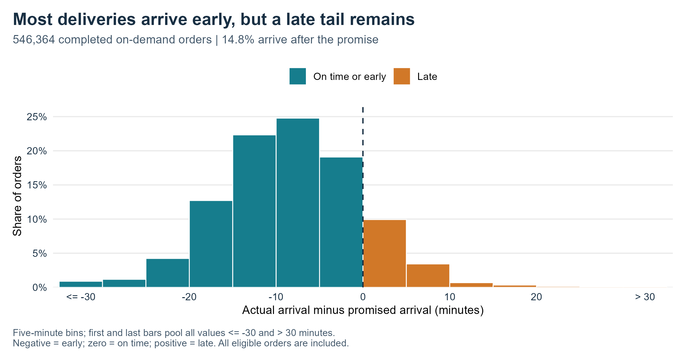
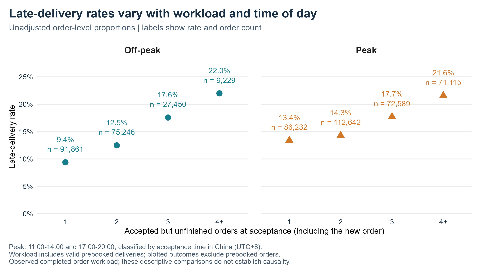

# One More Order - Milestone 3

Group 5: Grace Angeline Sun; Jennifer Nathania; Justin Thiadi; Mario Ananda Salim; Steven Indrawan.

**Research question.** How does multi-order courier workload relate to delivery lateness and courier productivity, and how do these relationships differ between peak and off-peak periods?

We use Meituan delivery records dated October 17-24, 2022. From 654,343 waybill records, we retain one accepted record per order, remove 1 order without a valid completion time, and exclude 22,181 prebooked orders from the plotted outcomes. The resulting sample contains 546,364 completed on-demand orders from 4,890 couriers. Both figures are descriptive; no model or main analysis has been run.

## 1. Delivery timing relative to the promise

**What stands out.** Figure 1 plots actual arrival minus promised arrival. Most orders arrive early: the median is 8.3 minutes before the promise, and the middle half arrive between 13.5 and 3.0 minutes early. Nevertheless, 80,742 orders (14.8%) are late. At the 95th percentile, delivery is 4.9 minutes late; 3,940 orders (0.72%) are more than 15 minutes late. The pooled end bars retain extreme observations.

**Why it matters.** A typical early delivery can coexist with a meaningful late-delivery problem, so averages alone would hide the service risk motivating our question. In the final analysis, we plan to examine both the probability of lateness and delivery duration, with sensitivity checks for extreme timestamps. This figure establishes the outcome distribution; it does not show which factors explain the late tail.

## 2. Workload and late-delivery rates

Workload counts accepted but unfinished orders at acceptance, including the new order and valid prebooks. Simultaneous acceptances count together; completions at that second are removed first. One order at acceptance does not guarantee it remains unbatched later. Peak = 11:00-14:00 or 17:00-20:00 at acceptance, Asia/Shanghai; all other hours are off-peak.

**What stands out.** Figure 2 shows higher late-delivery rates at higher acceptance workloads in both periods. Off-peak, the rate rises from 9.4% with one unfinished order to 22.0% with four or more (a 12.6 percentage-point gap). During peak periods, it rises from 13.4% to 21.6%. Peak rates are higher at workloads one and two, but the periods converge at three and four or more orders. The four-or-more group contains 71,115 peak orders (20.8% of peak orders), versus 9,229 off-peak orders (4.5% of off-peak orders), showing a different workload mix.

**Why it matters.** The workload gradient motivates comparing workload groups, while the changing peak/off-peak gap motivates a workload-by-peak interaction. These are unadjusted associations: courier selection, delivery distance, location, restaurant waits, and promised time allowances may differ across groups. Workload is reconstructed from recorded completed deliveries, so missing tasks and the observation-window boundary may understate it. The figures cannot establish that batching causes lateness or that it improves productivity.

## Planned analysis

We plan to compare lateness and duration across workload groups while accounting for distance, area, time, and courier differences. We will then examine completed orders per active courier-hour, merging overlapping wave intervals and reconstructing wave starts from the earliest acceptance, as the source's supplementary document flags errors in wave_start_time. Finally, we will compare acceptance workload with total orders per wave and check alternative peak windows. This will assess whether the proposed productivity-timeliness trade-off is present.

Source: [Meituan data and dictionary](https://github.com/meituan/Meituan-INFORMS-TSL-Research-Challenge); [supplementary clarification](https://github.com/meituan/Meituan-INFORMS-TSL-Research-Challenge/blob/main/tsl_meituan_2024_data_report_20241015.pdf), section 2.2.

This research was supported by data provided by Meituan.
